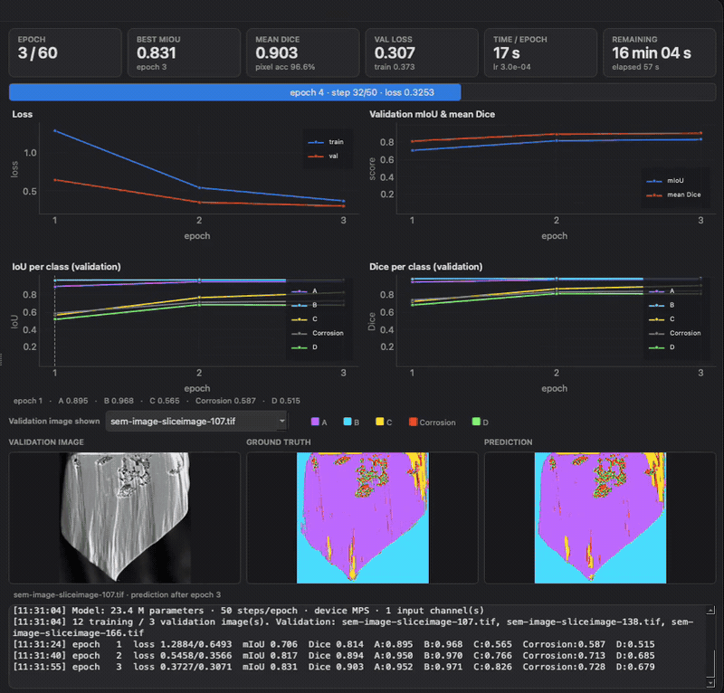
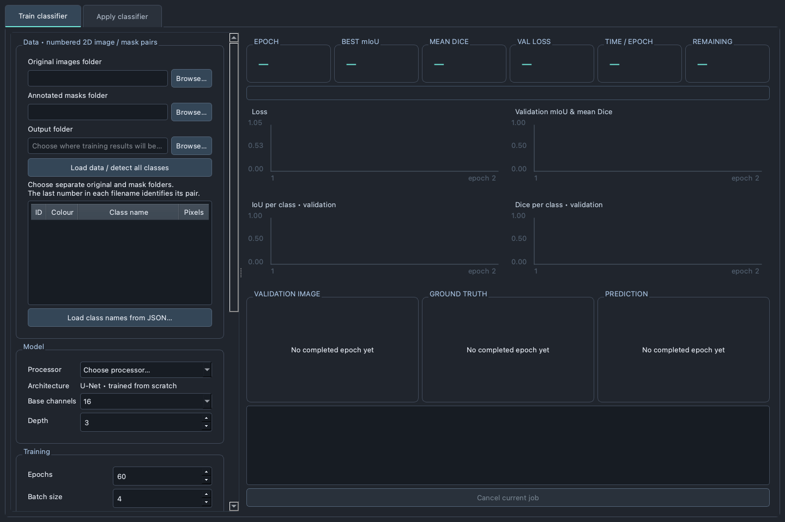
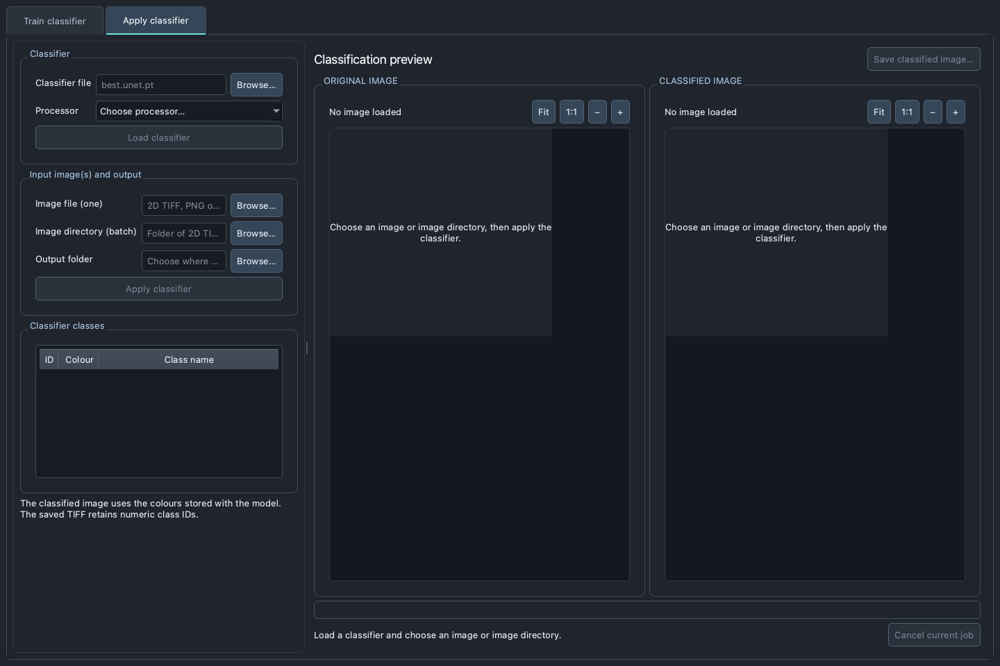

<h1 align="center">U-Net Classifier GUI</h1>

<p align="center">
  A native desktop application for training and applying 2D U-Net image-segmentation models—without writing Python code.
</p>

<p align="center">
  
  
  
  
</p>

<p align="center">
  <a href="docs/media/training-demo.mp4">
    
  </a>
  <br>
  <sub>Live training metrics and validation predictions.</sub>
  <br>
  <a href="docs/media/training-demo.mp4"><strong>▶ Watch the full 2:52 demonstration (MP4)</strong></a>
</p>

## Overview

U-Net Classifier GUI turns folders of original images and completed segmentation
masks into a trained U-Net classifier. It detects mask classes, keeps image-level
training and validation splits separate, displays live quality metrics, and exports
the best-performing checkpoint. A second workflow applies that checkpoint to either
one image or an entire directory.

The application is designed for users who want an inspectable desktop workflow for
scientific or technical 2D image segmentation while retaining explicit control over
the data, processor, model size, and training settings.

> [!IMPORTANT]
> This software trains models from the data you provide. Its automated tests verify
> software behavior, not the scientific validity of a trained model. Validate every
> classifier on independent, representative specimens before drawing conclusions.

## Highlights

| Capability | What it provides |
| --- | --- |
| Native desktop interface | PyQt6 application with separate training and classifier-application tabs |
| Automatic pairing | Matches original images and masks by the last number in each filename |
| Explicit class handling | Detects integer or discrete-colour classes without hidden merging or resizing |
| Live training dashboard | Loss, mIoU, mean Dice, per-class IoU/Dice, timing, and validation previews |
| Configurable U-Net | Adjustable base channels and depth, trained from scratch |
| Best-checkpoint saving | Retains the epoch with the highest validation mIoU |
| Single and batch inference | Classifies one image or every supported image directly inside a selected directory |
| Reproducible records | Saves settings, class metadata, split indices, histories, probabilities, and provenance |
| Hardware choice | CPU, Apple Silicon MPS, or NVIDIA CUDA when supported by the installed PyTorch build |
| Responsive execution | Data inspection, training, and inference run in isolated worker processes |

## Interface

<table>
  <tr>
    <td align="center"><strong>Train classifier</strong></td>
    <td align="center"><strong>Apply classifier</strong></td>
  </tr>
  <tr>
    <td></td>
    <td></td>
  </tr>
  <tr>
    <td>Load paired data, name classes, configure the model, and follow validation performance live.</td>
    <td>Load a checkpoint and classify a single image or a complete input directory.</td>
  </tr>
</table>

The recording above focuses on a populated training dashboard. The screenshots in
this section show the current release, including the separate Apply classifier tab
and directory-batch input.

## Requirements

- Python 3.12 or newer
- macOS, Windows, or Linux with a graphical desktop
- Enough memory for the selected model, patch size, and batch size
- Optional: Apple Silicon for MPS or a compatible NVIDIA GPU and CUDA-enabled
  PyTorch installation

## Quick start

1. Download or clone this repository.
2. Extract it if you downloaded a ZIP archive.
3. Start the launcher for your operating system:
   - **macOS:** double-click `Launch U-Net Training.command`
   - **Windows:** double-click `Launch U-Net Training.bat`
4. On the first run, approve creation of the local `.venv` when prompted.

The launcher installs dependencies only inside `.venv` in the project folder. It
does not change the system Python or install anything without confirmation. An
internet connection is required for the first installation.

### Manual installation

<details>
<summary><strong>macOS or Linux</strong></summary>

```bash
python3.12 -m venv .venv
.venv/bin/python -m pip install --upgrade pip
.venv/bin/python -m pip install -e .
.venv/bin/python train.py
```

</details>

<details>
<summary><strong>Windows PowerShell</strong></summary>

```powershell
py -3.12 -m venv .venv
.venv\Scripts\python -m pip install --upgrade pip
.venv\Scripts\python -m pip install -e .
.venv\Scripts\python train.py
```

</details>

Installation also provides the `unet-classifier` command inside the active virtual
environment.

## Preparing training data

Keep original images and completed masks in separate directories. The **last number**
in each filename identifies the pair:

```text
dataset/
├── originals/
│   ├── sample-001.tif
│   ├── sample-002.tif
│   └── sample-003.tif
└── masks/
    ├── Annotated_001.tif
    ├── Annotated_002.tif
    └── Annotated_003.tif
```

### Input rules

- Originals: single-page 2D TIFF, PNG, or JPEG; grayscale or RGB
- Masks: single-page 2D TIFF or PNG with complete categorical labels
- Original and mask dimensions must match exactly
- All originals in one training set must have the same channel count
- At least two pairs are required so whole images can be reserved for validation
- Two through 256 training classes are supported
- Images are never silently resized, aligned, or colour-clustered

For meaningful evaluation, prefer validation images from independent specimens over
adjacent, highly similar slices.

## Training a classifier

1. Select the **Original images folder** and **Annotated masks folder**.
2. Choose an **Output folder**.
3. Click **Load data / detect all classes**.
4. Review the detected IDs, colours, and pixel counts; edit the class names if needed.
5. Choose CPU, NVIDIA CUDA, or Apple Silicon MPS.
6. Configure the U-Net and training settings.
7. Click **Train U-Net**.

During training, the dashboard reports:

- training and validation loss;
- best validation mean intersection-over-union (mIoU);
- mean and per-class Dice scores;
- per-class IoU;
- elapsed and estimated remaining time; and
- side-by-side validation image, ground truth, and prediction previews.

Each run is written to a new timestamped directory:

```text
run-YYYYMMDD-HHMMSS-ffffff/
├── best.unet.pt   # Best validation-mIoU checkpoint
├── run.json       # Settings, source paths, and image-level split indices
├── history.json   # Per-epoch measured metrics
└── preview.npz    # Latest validation preview arrays
```

## Applying a classifier

1. Open the **Apply classifier** tab.
2. Select a `best.unet.pt` checkpoint and an available processor.
3. Click **Load classifier** to inspect its stored class IDs, colours, and names.
4. Choose either:
   - **Image file (one)** for single-image inference, or
   - **Image directory (batch)** for every supported image directly inside a folder.
5. Choose an output folder and click **Apply classifier**.

The original and colour-classified result are shown side by side. The full result
directory contains:

```text
prediction.tif       # Numeric class-ID mask at the source dimensions
probabilities.npz    # Per-class float32 probability maps and class IDs
classes.json         # Class names, colours, and numeric IDs
source.json          # Source, checkpoint, and processor provenance
```

Batch inference creates one numbered result directory per image and a `batch.json`
manifest mapping every source file to its output. The preview and **Save classified
image** button refer to the most recently completed image.

## Processor support

The processor menus always list all three backends. Unsupported accelerators are
shown as unavailable and cannot be selected. The application never silently falls
back to another processor.

| Processor | Availability |
| --- | --- |
| CPU | Available on every supported platform |
| Apple MPS | Requires a compatible Apple Silicon system and PyTorch build |
| NVIDIA CUDA | Requires a supported NVIDIA GPU, driver, and CUDA-enabled PyTorch build |

For CUDA, use the official
[PyTorch installation selector](https://pytorch.org/get-started/locally/) to install
the correct build into `.venv`, then restart the application.

## Privacy, safety, and reproducibility

- The application has no telemetry and uploads nothing.
- Original images and masks are never modified.
- Outputs are written only beneath the folder selected by the user.
- Diagnostic records remain local and are excluded from Git.
- Checkpoints are loaded with PyTorch's restricted `weights_only=True` mode.
- No automatic processor fallback, mask resizing, or class merging is performed.

Inspect predicted masks and probability maps before using them in downstream work.
See [SECURITY.md](SECURITY.md) for security reporting guidance and the
[training manual](TRAINING%20MANUAL.txt) for detailed methodology and limitations.

## Development and testing

Install the development dependencies and run the test suite:

```bash
.venv/bin/python -m pip install -e '.[dev]'
QT_QPA_PLATFORM=offscreen .venv/bin/python -m pytest
```

On Windows, omit `QT_QPA_PLATFORM=offscreen`. Hardware-specific MPS and CUDA tests
are skipped automatically when those processors are unavailable. GitHub Actions
runs the CPU and GUI checks on every push and pull request.

Additional project information:

- [Validation record](VALIDATION.md)
- [Contributing guide](CONTRIBUTING.md)
- [Security policy](SECURITY.md)

## Technology

- [PyTorch](https://pytorch.org/) for the U-Net and tensor computation
- [PyQt6](https://www.riverbankcomputing.com/software/pyqt/) for the desktop interface
- [NumPy](https://numpy.org/), [tifffile](https://github.com/cgohlke/tifffile), and
  [Pillow](https://python-pillow.org/) for image and array I/O

## Acknowledgements

This project was developed with assistance from
[OpenAI Codex](https://developers.openai.com/learn/codex) for code generation,
testing, documentation, and repository preparation. All AI-assisted changes were
reviewed and approved by the repository owner.

## License

Copyright © 2026. All rights reserved. See [LICENSE](LICENSE).

No open-source license has been selected. Public availability on GitHub does not by
itself grant permission to copy, modify, or redistribute the software.
